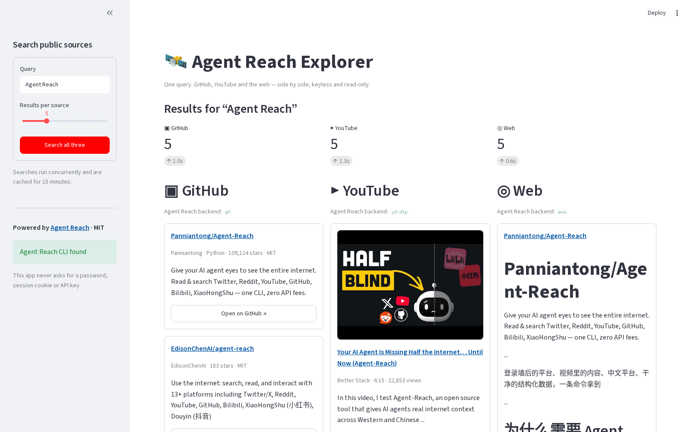

# agent-reach-explorer

A read-only Streamlit app powered by [Agent Reach](https://github.com/Panniantong/Agent-Reach) (MIT). Search **GitHub repositories, YouTube videos and the web** at once, compare results in three columns, inspect per-source failures, and download a combined CSV.

Bookmark source: [Agent Reach post on X](https://x.com/thegreatest_sv/status/2117687388214272339).



## Run it (Windows PowerShell)

```powershell
cd $HOME\Downloads
if (-not (Test-Path tech-demos)) { git clone https://github.com/mt10201/tech-demos.git }
cd tech-demos
git fetch origin
git checkout -B demo/agent-reach-explorer origin/demo/agent-reach-explorer
git log -1 --oneline
cd apps\agent-reach-explorer
if (-not (Test-Path .venv)) { py -3 -m venv .venv }
Set-ExecutionPolicy -Scope Process -ExecutionPolicy Bypass -Force
.\.venv\Scripts\Activate.ps1
pip install -r requirements.txt
streamlit run app.py
```

macOS / Linux: `python3 -m venv .venv && . .venv/bin/activate && pip install -r requirements.txt && streamlit run app.py`.

**Install surprise:** the PyPI package named `agent-reach` is **not this project**. `requirements.txt` deliberately installs the official release ZIP from `Panniantong/Agent-Reach` on GitHub. No `agent-reach setup`, login or key is needed for these three sources. The app's CLI is inside the same virtual environment as Streamlit, so activation matters.

## Using it

1. Enter a query and result limit in the sidebar, then select **Search all three**.
2. GitHub, YouTube and web requests run independently and concurrently. Results appear side by side with direct source links; YouTube cards include thumbnails. One blocked source does not suppress the other two.
3. The bottom **Table & CSV** tab combines results for export. **Source diagnostics** shows the backend and any error returned by Agent Reach.
4. Results are cached in memory for 15 minutes. Change the query or restart the app for a fresh search.

## Needs session / key gates

These are documented in the UI but deliberately **not called** by the app:

- **Reddit:** Agent Reach requires a signed-in browser session.
- **X / Twitter:** signed-in session; upstream labels it experimental.
- **LinkedIn:** signed-in site search is gated. The app does not copy or access browser sessions.
- **YouTube speech-to-text:** requires a Groq or OpenAI key. Configure such a key only through Agent Reach's own local terminal flow, never in this app.

No passwords, cookies, sessions or API keys are collected. The app exposes only `github search`, `youtube search` and `web search`.

## API and reliability notes

- Tested with Agent Reach **1.6.1**, Python 3.13 and Streamlit. The adapter invokes `agent-reach <source> search <query> --limit N --timeout 90` with an argument list (no shell), captures stdout, and parses its JSON object.
- Successful v1.6 searches return top-level `ok`, `channel`, `backend`, `items`, `meta` and `error`. Items already share `title`, `url`, `author`, `published_at`, `text` and `raw`; source-specific stars, language, license, duration and views come from `raw`.
- Leading dependency log lines are tolerated by the JSON parser. Timeouts, missing executables, malformed output and upstream errors become per-source messages.
- Agent Reach delegates to `gh`/GitHub API, `yt-dlp` and Exa. Sites can change markup, APIs or bot blocking at any time; rate limits and temporary failures are expected. This demo makes no uptime guarantee.

## Tests and media

```bash
pip install pytest
pytest -q tests
```

`media/`: `01-ready.png`, `02-three-source-results.png`, `03-video-web-results.png`, `04-session-key-gates.png`, `05-table-csv.png`, and the 23-second `06-walkthrough.mp4`.

## Layout

```
app.py                Streamlit UI
reach/client.py       bounded CLI adapter, normalization and CSV
tests/                offline critical-logic tests
scripts/capture.py    Playwright screenshot/video capture
media/                screenshots and walkthrough
requirements.txt      Streamlit + official GitHub Agent Reach release
PLAN.md               project plan and implementation notes
```
