# build123d-param-cad — Rodin coil torus

Parametric CAD playground: a **torus (donut) with Rodin-style semicircle grooves**, built with [build123d](https://build123d.readthedocs.io/) + Streamlit and previewed with Plotly. The default preset, **Photo replica**, reproduces the crisscross groove lattice of a real rainbow Rodin coil frame: 12 + 12 grooves spiralling in both directions, with raised rhombus tiles between them. The earlier **Rodin golden spiral** and **Mirror golden spiral** presets are still available.

Bookmark source: [gregisenberg hardware/robotics tooling list](https://x.com/gregisenberg/status/2100229768385822812). The default size is a set of royal-cubit harmonics; the owner's original SOLIDWORKS sketch size is still an option.

This is **not** a 3D-printer settings app. It designs the shape; slice the STL elsewhere.

## Size: royal-cubit harmonics (default)

The royal cubit is taken as **C = 52.36 cm = 523.6 mm** (`ROYAL_CUBIT_MM` in `geometry.py`). Both circumferences of the torus are harmonic fractions of it:

| Circumference | Fraction | Length | Radius |
|---|---|---|---|
| Tube cross-section, 2πr | **C/4** | 130.90 mm (13.09 cm) | r = C/(8π) = **20.833 mm** (0.8202") |
| Ring centre-line seen from above, 2πR | **C/2** | 261.80 mm (26.18 cm) | R = C/(4π) = **41.667 mm** (1.6404") |

That gives an outer Ø of 2(R + r) = **125.0 mm**, a height of 2r = **41.67 mm**, and a hole Ø of 2(R − r) = 41.67 mm. R/r = 2, the same proportions as the SOLIDWORKS sketch. It fits an Ender 2 bed (150 × 150 mm). In the sidebar, *Torus size ▸ Royal cubit harmonics* lets you pick ¼, ½ or 1 cubit for each circumference. A full-cubit ring with a ¼-cubit tube is about 208 mm across. Tube and ring set to the same fraction would self-intersect, and the app says so. *SOLIDWORKS sketch (inches)* restores R = 1.39", r = 0.695" (105.9 mm OD), and *Custom (mm)* takes any R and r.

| Parameter | Default |
|---|---|
| Size | **Royal cubit**: R = 41.667 mm, r = 20.833 mm, 125.0 × 125.0 × 41.67 mm |
| Pattern | **Photo replica**: 12 grooves per direction, both directions |
| Sweep rim → hole | **150°** (measured from the photo) |
| Groove width | **1/8" = 3.175 mm**, measured in true 3D; slider 1/16"–1/2" |
| Groove depth | **1/8" = 3.175 mm**; slider 1/32"–1/4" |
| Profile | **U-groove**: semicircular floor of radius 1/16" (1.5875 mm) plus straight walls 1/16" tall. depth = width/2 is a pure semicircle; depth < width/2 is a shallow arc |

**Units.** The maths runs in inches internally because the groove sizes are inch fractions. **Every download is in millimetres**: the STL vertices and the STEP geometry are scaled ×25.4, the STEP header says millimetre, and file names end in `_mm`. Import at 100 % scale in a slicer. Earlier versions of this demo wrote inch numbers, so slicers read them as mm and the part came in 25.4× too small.

## Photo replica: what was measured

These numbers come from a polar unwrap and copper-colour mask of the photo:

- **Counts:** the angular period of the copper channels is 29–30° at three radii, so **12 grooves per direction**, 24 in total. There are about 24 tiles per ring.
- **Pitch:** the dominant family's azimuth grows almost **linearly with tube angle θ**, with dφ/dθ ≈ 0.84–0.87. It is *not* a golden spiral: a golden spiral would need about 190° over the measured radius range, but the photo shows about 85°. Extrapolated rim → hole, that's about **150°** (5 of the 12 poles, the Rodin skip), or about 300° per full wrap.
- **Directions:** the two directions look mirror-symmetric, judging by the diamond tiles. The second, thinner family was hard to isolate automatically.
- **Channel width:** each channel holds **one twisted multi-strand bundle**. One direction's bundles are about twice as thick as the other's. Scaled to a 4.17" OD, the channels are only about 0.06–0.11" wide.
- **Proportions:** the photo's hole is about 138 px against an OD of about 603 px, so hole/OD ≈ **0.23** and r/R ≈ 0.63. The owner's part (both the SOLIDWORKS and the cubit size) is 0.333 and 0.50: a noticeably bigger hole and a slimmer tube.

## How the grooves are built

Torus coordinates: `point(θ, φ) = ((R + ρ cos θ) cos φ, (R + ρ cos θ) sin φ, ρ sin θ)`, with θ around the tube (0 = outer equator/rim, 90° = front face, 180° = hole) and φ around the main axis.

**Photo replica (default):** `φ = φ₀ ± (sweep/180°)·θ`, with θ going 0 → 360°, `φ₀ = rotation + i·30°`, and 12 grooves for each sign. Each groove is a constant-pitch helix that wraps the full torus. With sweep = 150°, a wrap advances 300° (10 poles), so the grooves join end-to-start into seamless closed loops. Any multiple of 15° does the same.

**Wall thickness:** grooves of *opposite* direction are meant to cross. In the photo preset they cross every 18° of θ along each groove, and on the inner equator both families cross at the same 12 points, 30° (10.9 mm) apart. Neighbours in the *same* direction come closest at the hole (θ ≈ 188°). Their perpendicular centre-line spacing there is `(2π q/N)·sin α`, with `q = R − r`, `tan α = r/(q·k)` and `k = sweep/180°`, which comes to **8.38 mm (0.330")** at the cubit size. Subtracting the groove width gives the wall. The app computes this numerically for every pattern (3D closest approach of the surface centre-lines) and warns when the wall drops below 1 mm (0.04") or goes negative (grooves merge):

| Width | Min wall at the hole (cubit size) | (SOLIDWORKS size) |
|---|---|---|
| 1/8" = 3.175 mm (default) | **+5.22 mm** (0.205") | +0.155" |
| 3/16" | +3.63 mm | +0.092" |
| 1/4" | +2.04 mm | +0.030" |
| 5/16" | +0.45 mm | −0.033" (merge) |
| 3/8" | −1.13 mm (merge) | −0.095" (merge) |

The wall depends only on width, not depth. A U-groove keeps the same width at any depth.

**Golden-spiral presets:** these are the earlier variants, described below.

1. **Profile.** This is the same true-3D profile as the photo preset (see *Outputs*).
2. **Path: one helical wrap per groove.** θ goes 0 → 360° once around the tube while φ advances around the main axis.
3. **Top half = golden spiral.** On θ 0 → 180° (outer equator → over the top → inner equator) the azimuth is
   `φ = φ₀ + (π/2)·log_φ(q_max / q)`, `q = R + r cos θ` (surface centre-line),
   so the projected radius shrinks by φ ≈ 1.618 for every 90° of azimuth. From the rim to the hole (ratio 3 for R/r = 2) that's a **205.5°** golden-spiral sweep.
4. **Bottom half (closure option).**
   - **Rodin (default):** the bottom half sweeps 510° − 205.5° so each wrap advances 360° + 150° (the classic Rodin 5-of-12 pole skip). Groove *i* ends exactly where groove *i+5* starts, so the 12 grooves chain into **one continuous closed winding**.
   - **Mirror:** the bottom half is the mirror golden spiral (205.5°), giving 12 open grooves and the crossing rosette you see in the SOLIDWORKS top view.
5. **Handedness** and **start-pole rotation** are sliders.

For these presets, the numeric minimum-wall check also flags merging at 3/16" depth.

## Outputs

- **3D preview, front view and STL: real mesh boolean** (`boolean_mesh.py`, [manifold3d](https://github.com/elalish/manifold)). This replaces the earlier heightfield, whose grid aliasing caused stair-stepped groove walls.
  1. The torus is tessellated from its chord error: segment counts around the axis and the tube are chosen so that no facet deviates more than `chord` from the true surface.
  2. Each groove's centre-line is traced on the surface. Grooves that join end-to-start are chained into closed loops: the photo preset gives 4 loops, 2 per direction.
  3. The U profile (straight walls plus a semicircular floor of radius w/2, extended 0.03" above the surface) is swept along each loop. The sweep uses a frame built from the torus normal, so the walls stay normal to the surface.
  4. `torus − union(all cutter tubes)` is evaluated by manifold3d. The result is guaranteed manifold, and every wall and floor is a swept surface, not a grid.

  | | chord error | step along path | arc segments | triangles | binary STL | time |
  |---|---|---|---|---|---|---|
  | Live preview | 0.05 mm | 1.3 mm | 8 | ~144 k | — | ~0.5 s |
  | **Prepare high-res STL** | **0.013 mm** | 0.5 mm | 24 | **676,560** | **33.8 MB** | ~3 s |

  The boolean runs in float64 (`Mesh64`). With float32, about 1.5 k zero-area slivers became non-manifold edges once a slicer merged vertices. The high-res STL (cubit size) is watertight and winding-consistent, also after re-loading it with merged vertices the way a slicer does. Its bounding box is **124.84 × 124.84 × 41.64 mm** and the true outer Ø is 125.00 mm: grooves happen to cross the X and Y axes and the top and bottom, so the box is a little smaller than the plain torus. Volume is 310.2 cm³. Width, measured on the actual STL by slicing it with a plane perpendicular to the path 9° away from a crossing: **3.175 mm at the rim, on top, at the hole and on the bottom**. The floor is 3.175 mm deep at all four (`tests/test_geometry.py::test_boolean_mesh_groove_width_and_depth`). For display only, the preview drops zero-area slivers and splits vertices at creases sharper than 35°, so smooth shading keeps the groove lips crisp.
- **Close-up section:** 16 mm (0.64") samples of the high-res STL at the outer rim and the inner hole, at the same scale. Each is cut out with a manifold ball intersection. Alongside them are cross-sections of the actual STL at rim, top, hole and bottom; all four profiles are identical. The sidebar's *3D camera ▸ Zoom across the hole* gives a close-up of the groove walls.
- **Front view:** an orthographic view looking along the axis, like the photo. Tiles are rainbow-coloured by azimuth and grooves are copper.
- **Prepare STEP — finished solid:** a true B-rep with the grooves already subtracted (`rodin_torus.finished_solid`). The torus and 24 swept U cutters come from build123d. The U profile uses an auxiliary spine, so the walls stay normal to the torus. Cutting everything in one OpenCascade boolean, or cutting a union of all cutters, returns invalid shapes. **Sequential fuzzy cuts work**: one `BRepAlgoAPI_Cut` per groove with fuzzy value 1e-4 (retried at 1e-3), and after each cut the result is checked to be a valid solid with decreasing volume. For the photo preset at the cubit size the result is a valid solid of 310.8 cm³ with 1701 faces. It re-imports as 1 valid solid of 124.86 × 124.86 × 41.67 mm. It takes about 4.5 min and the STEP is about 84 MB, which is why it is built on demand rather than committed. The STEP is written in millimetres.
- **Build STEP tool bodies (fast fallback):** the torus, cutter bodies and centre-lines (mm), in about 10 s. In SOLIDWORKS: open the STEP → *Insert ▸ Features ▸ Combine* → *Operation type: Subtract* → *Main body*: the torus → *Bodies to subtract*: all 24 groove bodies → ✓.
- **Generated build123d snippet** for the current slider values (it produces the same STEP bodies).

## Mold master (silicone mold, two halves)

Sidebar ▸ **Mode ▸ Mold master** turns the current torus into positives to pour silicone over, laid out like a classic box mold: a light floor plate with half the grooved torus standing on it, four hemisphere registration keys in the corners, and a separate square pour frame around the plate (`mold.py`, `mold_page.py`).

- **Master A**: a square plate, the **top half** of the grooved torus (split at the equator z = 0, flat face fused to the plate) and 4 hemisphere key **bumps**. The plate runs under the donut hole, so the silicone fills the hole.
- **Master B**: the same plate with 4 hemisphere key **sockets** and the **bottom half**, turned over by a 180° rotation about X, (x, y, z) → (x, −y, −z). That is a rotation, not a mirror, so the casting isn't mirrored. Bumps on A make dimples in silicone A; sockets on B make bumps in silicone B. The keys sit at (±a, ±a), which maps onto itself under the rotation, so the two silicone halves register.
- **Symmetry:** the groove lattice is symmetric across the equator. Both families start on the same 12 poles: the 180° X-rotation maps the + family onto itself and the start angles {0°, 30°, …} onto themselves, so **the turned-over bottom half is identical to the top half**. The test measures a symmetric-difference volume of about 1e-9 of the half volume. Both masters are still exported, because their keys differ.
- **Torus:** the same smooth manifold3d mesh as the torus STL (royal cubit, 12 + 12 lattice, 3.175 × 3.175 mm U-grooves). On the masters the grooves measure 3.175 mm wide and 3.175 mm deep at 6 places, 3 on each half.

### Sizes (defaults) and the bed

The bed assumed is the **Creality Ender-2's 150 × 150 × 200 mm print volume**: the official spec and the stock Marlin `X_BED_SIZE`/`Y_BED_SIZE`. The aluminium plate itself is about 165 mm, but the firmware limits printing to 150 mm.

| Part (as printed) | X × Y × Z (mm) | Fits 150 × 150? |
|---|---|---|
| `mold_master_A_mm.stl` | 149.1 × 149.1 × 24.8 (4 mm plate + 20.83 mm half torus; locating groove) | yes, 0.45 mm to spare per side |
| `mold_master_B_mm.stl` | 149.1 × 149.1 × 30.8 (10 mm plate + 20.83 mm half torus; locating groove) | yes, 0.45 mm to spare per side |
| `pour_frame_mm.stl` | 145.6 × 145.6 × 32.4 (3 mm wall, 0.4 mm bottom chamfers) | yes, 2.2 mm to spare per side |

With **Locating groove** turned off you get the original butt-jointed layout: masters 139.0 × 139.0 mm, frame 145.6 × 145.6 × 34.8 mm standing on the table around the plate.

Defaults are: plate margin 7 mm from the torus edge to the plate edge, plate 4 mm, keys of radius 8 mm with a 3 mm edge gap (centres at ±58.5 mm, 12.2 mm clear of the torus), clearance 0.3 mm, wall 3 mm, and silicone cover 10 mm above the torus. The frame's inner size is the pour floor (torus + 2 × margin) + 2 × clearance; its height is groove depth + half torus + cover (without the groove: plate + half torus + cover). With the default locating groove the plate extends past the frame by 0.25 mm clearance + 1.5 mm lip (see below). Master B's plate is key radius + 2 mm = 10 mm, so the 8 mm sockets keep a floor; everything above the floor is the same as on A.

**Why a one-piece frame around the plate:** the 125 mm torus plus a 7 mm silicone wall plus 0.3 mm clearance and a 3 mm wall comes to 145.6 mm, so a one-piece frame fits. Panels or a frame sitting on the plate aren't needed at this size. The largest margin that still fits is about 9 mm (149.6 mm frame). Bigger margins need a printer with a larger bed; the app flags parts that don't fit. A **"ledge" option** gives the same footprint: the plate gets a raised pour floor and a 3.3 mm perimeter ledge, and the frame drops over the floor and rests on the ledge. It self-locates, and silicone has to climb a 2 mm step before it can leak. With frame and plate both 145.6 mm, there is less room on the bed. Silicone per half is about 442 cm³ (about 0.49 kg at 1.1 g/cm³).

### Locating groove (default on)

Sidebar ▸ **Locating groove for the frame wall** (on by default) cuts a shallow square channel into the top of **both** bases, A and B, that the bottom edge of the pour-frame wall drops into. The wall self-locates, and the seam becomes a labyrinth (down, across under the wall, up) instead of a butt joint, so silicone is far less likely to find a way out. You still hot-glue the **outside** seam: run the bead where the wall comes out of the groove, on the outer lip.

```
   cavity (silicone) │  frame wall │
 ────────────────────┤   3.0 mm    ├── lip 1.5 ──┐   ← z = 0: pour floor / plate top
                     │░           ░│             │
                     └┐───────────┌┘  groove     │   1.6 mm deep, 3.5 mm wide
                      └───────────┘              │   (0.25 mm clearance each side)
 ────────────────────────────────────────────────┘   plate (2.4 mm left under the groove on A)
```

| Default (mm) | Value | Why |
|---|---|---|
| Groove depth | **1.6** | 8 layers at 0.2 mm; deep enough to locate and seal, leaves 2.4 mm of the 4 mm plate under it on A (7.4+ mm on B). The plate is thickened automatically to keep ≥ 2 mm under the groove (e.g. the ledge variant). |
| Groove clearance | **0.25 per side** | channel = wall + 0.5 = 3.5 mm. On an Ender-2 (0.4 mm nozzle) a 0.2–0.3 mm gap slides in by hand without slop. |
| Outer lip | **1.5** | plate outside the groove (its outer wall, ~4 perimeters) and the land for the glue bead. |
| Wall bottom chamfer | **0.4 × 45°** on both bottom edges | the only change to the wall: relief for first-layer squish ("elephant foot") so the wall seats fully in a 0.25 mm-clearance groove. It also leaves a small V at the outside seam that the hot glue fills. |

Placement: the groove's inner edge is at 69.55 mm from the centre (cavity wall 69.8 mm − 0.25), **3.0 mm outside the key edges** and 7 mm outside the torus, so it never touches the cavity features; the frame's inner face and the silicone side wall are unchanged. The **frame keeps its 145.6 mm footprint**; it is 2 mm shorter (32.4 mm) because it now stands in the 1.6 mm groove instead of on the table next to a 4 mm plate (pour depth is still 30.8 mm). A frame you already printed from the old layout fits the new groove too (it is just 2 mm taller; with no chamfer it may need the first layer's squish scraped off). The plate grows to 149.1 mm (frame 145.6 + 2 × 0.25 clearance + 2 × 1.5 lip), which still fits the 150 mm bed: print it with no skirt/brim.

**Ledge variant + groove:** the ledge is lowered by the groove depth and gets the same 1.5 mm outer lip, so the island's step is the groove's inner wall (inner clearance = the frame clearance, 0.3 mm). Master A's plate is thickened to 5.6 mm (2 mm ledge + 1.6 mm groove + 2 mm floor). Same 149.1 mm plates and 145.6 mm frame (34.4 mm tall).

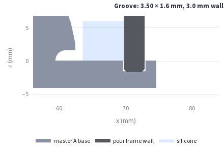

### Print

1. Print every part **as exported** (flat side down, in mm, 100 % scale). Turn off the brim and skirt: the grooved 149.1 mm plates leave only 0.45 mm per side on a 150 mm bed (the frame 2.2 mm). Masters A and B need no supports. The half torus faces upwards everywhere, and the groove ceilings near the plate are short 3.2 mm bridges.
2. Use 0.12–0.16 mm layers for the masters (smoother groove walls) and 3+ perimeters. The frame is fine at 0.2–0.28 mm.
3. Lightly sand the master: 400 → 800 grit wet, keeping the groove edges crisp. For a glossy silicone surface, seal it with a thin brushed coat (XTC-3D, or primer plus clear coat). Check that the sealer is compatible with platinum silicone, or use tin-cure silicone.

### Pour

1. Drop the frame's wall into the locating groove on the base (it should slide in by hand and sit flat all round), then run a continuous hot-glue bead along the **outside** seam, wall to lip, filling the corners. Keep glue off the inside face. Silicone will find a 0.3 mm gap. (Groove off: set the master on a flat sheet, drop the frame over it and seal the frame's outside bottom joint.) Hot glue peels off PLA after the cure, or lift it with a putty knife.
2. Spray or brush mold release (e.g. Ease Release 200) on the master and the frame, and let it flash off.
3. Mix about 450 cm³ of silicone (Shore 20–30A works well for this lattice) and degas it if you can. Pour in a thin stream into one **corner**, not onto the torus, and let it rise over the torus and keys. Fill to the top of the frame: that is 30.8 mm of silicone above the floor (20.83 mm torus + 10 mm cover).
4. Cure, de-mold, and repeat on master B. Put a dab of release on silicone A's dimples before casting into the pair.
5. **Pour and vent channels** go into the cured silicone. They aren't modelled, which keeps the masters simple. Cut a 6–8 mm funnel from the outside face to the rim of the torus cavity in one half, plus 1–2 thin vents at the high points (the top of the tube) in the other half. Clamp the two halves between boards; don't use rubber bands that squeeze the cavity.

STL: watertight (also after slicer vertex merge), built in about 4 s. STEP: **Prepare mold STEPs** builds exact B-rep `mold_master_A_mm.step`, `mold_master_B_mm.step` and `pour_frame_mm.step` in about 4.5 min. Almost all of that is the 24 sequential groove cuts; splitting and fusing take about 17 s. Each file re-imports as 1 valid solid whose volume is within 0.1 % of the STL. OpenCascade silently dropped the plate when fusing it with the *bottom* half of the finished torus. Because the halves are identical, master B's STEP is built from the top half instead. If you change the pattern so the halves differ (golden presets, an odd start rotation), the B STEP is checked against the mesh volume and the app says to use the STL if the boolean fails.

## Moai statue (side part)

Mode **Moai statue** in the sidebar has two models:

- **Real scan: Quarry Moai head** (default): a silicone mold master made from a photogrammetry scan of a
  real Rano Raraku quarry moai. Download `moai_head_scan_152mm.stl`.
- **Parametric (full statue)**: the stylised head-and-torso statue described further below. Download
  `moai_152mm.stl`.

### Real scan: Quarry Moai head (mold master)

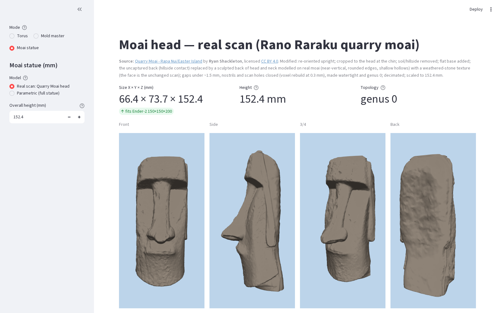

| Front | Side | 3/4 | Back |
|---|---|---|---|
| 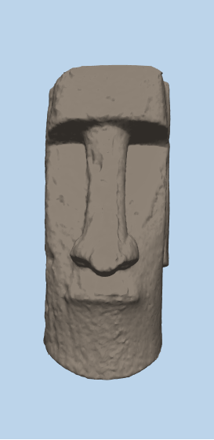 | 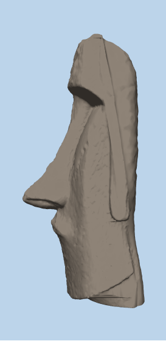 | 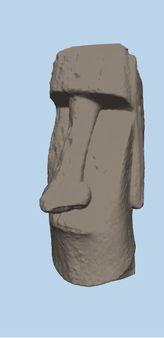 | 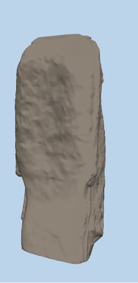 |

**Source and licence.** Adapted from
["Quarry Moai - Rapa Nui/Easter Island"](https://sketchfab.com/3d-models/quarry-moai-rapa-nuieaster-island-dd6027d79fe14549ab7b2eae0d94de5d)
by **Ryan Shackleton**, licensed under [CC BY 4.0](https://creativecommons.org/licenses/by/4.0/).

- This file is **modified** (see the list below).
- Commercial use, such as selling castings, is allowed if the credit is kept.
- The full attribution and the suggested credit line are in [`assets/ATTRIBUTION.md`](assets/ATTRIBUTION.md).
- The original scan (Sketchfab login, 37 MB zip) is **not** in the repo. Only the processed mesh is committed:
  - `assets/moai_head_scan_152mm.stl`: 23.5 MB, 470,720 triangles.
  - A light preview copy.

**What was done to the scan** (`scripts/build_moai_head_scan.py`, which reproduces the assets from the zip in about 40 s; it also needs `pip install fast-simplification`, which the app does not):

1. **Orient.** The head axis was made vertical (the quarry statue leans about 22° in the scan) and the face points to −Y.
2. **Crop and remove the soil.** The statue is buried to the neck: everything below the chin in the scan is the soil
   mound, and its back is the ragged contact with the hillside. The model was cut at the underside of the chin,
   which gives a **flat base**. Below the jaw line only the head's own footprint is kept. The ragged hillside
   contact at the back is cut to a plane fitted just inside it, with notches narrower than about 9 mm filled.
3. **Natural back (sculpted, modelled on real moai).** The scan never saw the back of the head, so one is added
   behind that plane. Real moai (Hoa Hakananai'a in the British Museum, Ahu Tongariki, the Louvre head) have the
   ears at the rear of the head's sides and a broad back of head just behind them: nearly flat and vertical,
   rounded rear edges and top-back corner, a slightly hollow centre, and a neck that flows into the shoulders.
   So, per height: a superellipse (exponent 4) as wide as the head, set by absolute position (the cut plane leans
   ~9°, the new back is near-vertical, parallel to the face) about 5–7 mm behind the ear lobes; a ~1 mm hollow in
   the centre between the raised rear edges; a quarter-ellipse round-over into the crown above 124 mm; a shallow
   concave nape and the neck flaring back toward the shoulders at the base. It carries a weathered-stone texture
   (smooth band-limited noise, ~0.7 mm, no spikes) that fades to zero at the join, and is blended into the scan's
   sides with a 4 mm smooth-min, so there is no seam. Nothing more than ~10 mm in front of the old flat back
   changes: the face is the untouched scan (before decimation the face vertices are bit-identical; after it the
   face differs from the previous version by at most 0.01 mm).
4. **Solid rebuild.**
   - Grid: 0.3 mm voxels, sampled from 5 M surface points.
   - Closing: 0.75 mm dilate, fill, 0.75 mm erode. This closes every gap or hole narrower than about 1.5 mm:
     the scan's texture-seam cracks (113k open edges), the sparse patch beside the right eye, the nostril
     slits and the thin, patchy front of the nose.
   - Cavities: internal ones are filled and only the largest piece is kept.
   - Tunnels: any hole enclosed within a horizontal slice is plugged (1.7 k voxels, behind the jaw and ears).
5. **Mesh.** Marching cubes, then 50% quadric decimation (mean deviation about 0.1 mm, max about 0.23 mm).
   Rescaled to exactly 152.4 mm.

**Check** (`tests/test_moai_scan.py`):

- Watertight, consistent winding, a valid volume, a single body.
- **Euler characteristic 2, so genus 0**: no through-holes or tunnels. The area under the nose is a closed
  recess, not a gap.
- **66.4 × 73.7 × 152.4 mm**, base about 54 × 46 mm. Fits the Ender 2 bed.
- The back is a single-valued surface seen from behind (the hollows are ~1 mm and open), so it pulls cleanly.

**Print and mold notes:**

- Print upright on the flat base, 0.12 mm layers, 3–4 walls.
- Tree supports under the brow, the nose tip and the chin.
- Sand, prime or seal the print before pouring.
- The brow, nose and chin are real undercuts, but there are no locks:
  - one-piece mold: soft silicone (Shore 10–20 A), poured over the master standing on its base;
  - two-piece mold: split along the ear line.
- Credit the scan author on listings or products (see `assets/ATTRIBUTION.md`).

**Caveats:**

- The back of the head and the neck were never captured, because the statue stands against and in the hillside.
  The back and the flat base are sculpted geometry modelled on real moai backs, not this statue's real shape.
- Detail finer than about 0.5 mm (fine weathering) is softened by the 0.3 mm voxel grid and the closing.
- The scan's own blue artefacts on the nose were texture only. The geometry there was intact apart from small holes, which are now closed.

### Parametric (full statue)

The stylised head-and-torso statue sculpted in code. It has a height input, an optional base plinth and the
same front / side / 3/4 preview; the default download is `moai_152mm.stl`.

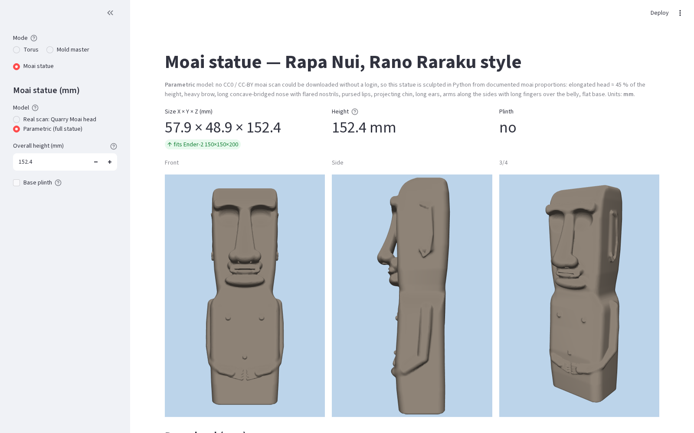

| Front | Side | 3/4 |
|---|---|---|
| 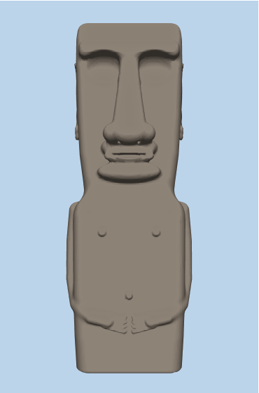 | 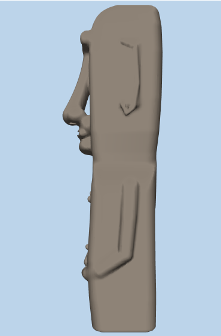 | 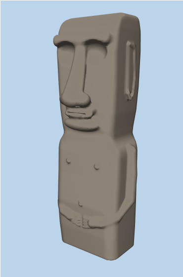 |

**Source: parametric.** I looked for a scan I could download without logging in and whose licence
allows reuse (CC0 / CC-BY / CC-BY-SA):

- British Museum Hoa Hakananai'a: CC BY-NC-SA, not allowed.
- Scan the World / Printables: NC licences, not allowed.
- Smithsonian 3D: no moai.

The CC-BY scans below are real, but Sketchfab requires a login to download them. You can swap one
in by hand:

- [Moai - Museo Nacional de Historia Natural de Chile](https://sketchfab.com/3d-models/moai-7099390468214c2dbcf283454e7b5c8a)
- [Quarry Moai - Ryan Shackleton](https://sketchfab.com/3d-models/quarry-moai-rapa-nuieaster-island-dd6027d79fe14549ab7b2eae0d94de5d)
- [Moai from Easter Island - Phelpst](https://sketchfab.com/3d-models/moai-from-easter-island-1e30cdc662594dd59e716c3aa7186b88)

So `moai.py` sculpts the statue as a signed-distance field (numpy) and meshes it with
scikit-image marching cubes. The proportions are fractions of the height H, taken from the
typical Rano Raraku moai:

| Feature | Value |
|---|---|
| Head (chin to crown) | ≈ 45 % of H |
| Shoulders | at 0.52 H |
| Nose tip | at 0.665 H |
| Eyes | at 0.85 H |
| Heavy brow | at 0.90 H |
| Flat top of the head | — |

Other features:

- Long concave-bridged nose with flared nostrils.
- Pursed, projecting lips and chin.
- Long ears with a raised rim.
- Arms down the sides, with long fingers meeting over the belly.
- Nipples and navel.

At 152.4 mm the statue is **57.9 × 48.9 × 152.4 mm** (X × Y × Z). It fits the Ender 2
(150 × 150 × 200).

**Mesh:**

- The download is a ~0.5 mm marching-cubes grid, about 214k triangles.
- It is watertight and consistently wound, also after a slicer-style vertex merge, and is a valid volume.
- It stands on z = 0.
- The plinth (6 mm, 4 mm margin) is unioned with manifold3d. The overall height stays the value you enter.

**No STEP:** the statue is an organic mesh, and a faceted STEP with ~200k triangles is not a useful CAD file.

**Print:**

- Upright on the flat base.
- 0.12–0.16 mm layers, 3 walls, 10–15 % infill.
- Supports *everywhere*, or tree supports, for the overhangs under the brow, nose tip, lips and chin.
  Those faces overhang ~70–90°.
- Fingers and ear rims are ~1–1.5 mm. Print with a 0.4 mm nozzle and don't scale below ~100 mm.
- Turn on the plinth for better bed grip.

## Frame clamps (bd_warehouse threads, optional Mold master accessory)

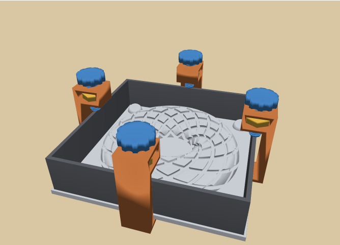

In **Mold master**, tick **Frame clamps (optional) ▸ Threaded wall clamps (bd_warehouse)**. You get printable
C-clamps that hook under the plate and push the pour-frame wall down into the locating groove, so the seam
seals with less hot glue and the frame can't float. **The masters are unchanged**: the clamps are separate parts.
They need the wall to stand on the plate (locating groove on, or the "ledge" frame style). The app shows an
error otherwise.

- Code: [`mold_clamp.py`](mold_clamp.py). Threads are `bd_warehouse.thread.IsoThread` (bd_warehouse 0.4.0,
  Apache-2.0, pure Python), ISO coarse M6/M8/M10/M12 (default **M10×1.5**). They use `manufacturing_compensation`
  (default **0.15 mm**, slider 0–0.4): the screw thread shrinks inward and the nut thread grows outward. At the
  default 0.15 mm the pair has a backlash window (tested). At 0 the profiles always overlap, so printed parts bind.
- Parts (4 or 8 sets): **clamp body** (lie it on its side; the teardrop hole needs no supports), **hex nut**
  (fits the clamp's through-slot, or use a steel DIN 934 M10 nut) and **thumbscrew** (print it head down; the
  head has a 45° bottom chamfer).
- One clamp fits both masters. With the defaults: screw travel 10 mm covers frame tops A and B, clamp
  height 64.8 mm, screw tip ≤ wall thickness.
- Checks (tests/test_clamp.py): every part at M6–M12 is a valid single solid with a watertight STL (Euler
  clamp −4 / nut 0 / screw 2, through holes are expected: these are not mold masters). Every part fits the
  Ender 2. manifold3d interference volume is 0 between clamp and master, clamp and frame, screw and clamp,
  nut and clamp, and screw and frame (A and B).
- Download: STL (mm) + STEP for each part (button *Prepare clamp STL + STEP files*).
- **Not added from bd_warehouse:** gears (no geared part in this project), pipes/flanges/bearings/fasteners
  and a threaded pour spout (a thread in the pour path makes a hole in the silicone).

## Photo → master (any AI / scan mesh → printable mold master)

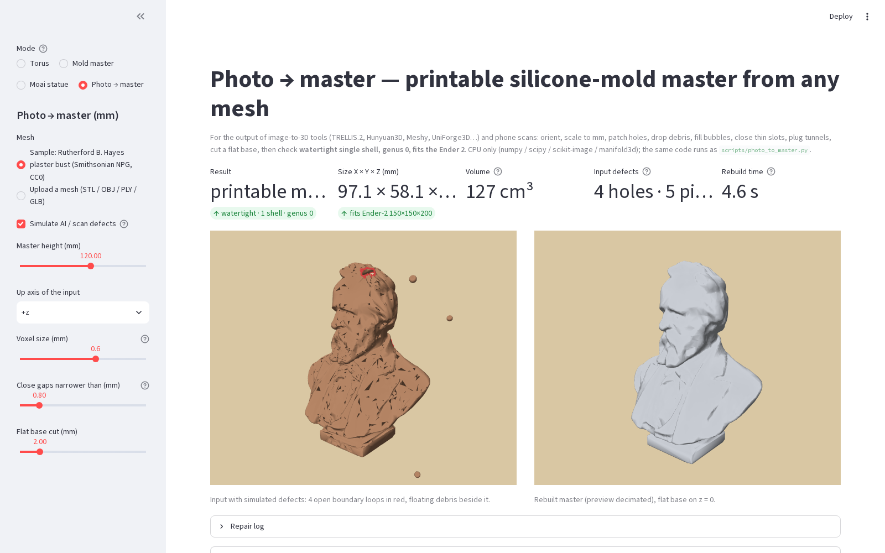

The **Photo → master** mode takes the output of image-to-3D tools (TRELLIS.2, Hunyuan3D, Meshy, UniForge3D…)
or a phone scan and makes a mold master. It orients and scales to mm, patches holes, drops debris, fills
bubbles, closes thin slots, plugs tunnels (genus 0), cuts a flat base, then checks for a **watertight single
shell, Euler 2, fits the Ender 2**. It runs on CPU with the existing requirements
([`scan_repair.py`](scan_repair.py)). The bundled sample is the **CC0** Smithsonian NPG plaster bust of
Rutherford B. Hayes (Olin Levi Warner, 1876, [`assets/ATTRIBUTION.md`](assets/ATTRIBUTION.md)). *Simulate AI
/ scan defects* punches holes and adds flipped and duplicate faces, debris and a bubble, so you can watch the repair.

```bash
python scripts/photo_to_master.py model.glb master.stl --height 120            # glTF assumed +Y up (--up to change)
python scripts/photo_to_master.py assets/hayes_bust_npg_cc0.ply /tmp/hayes.stl --damage-demo --voxel 0.6
# -> 4 holes patched, 3 debris pieces dropped, 130,624 triangles, 98.3 × 58.8 × 120 mm, 130.6 cm³,
#    watertight, Euler 2, fits Ender 2 — 4.5 s on 8 CPUs (0.4 mm voxels: ~12 s)
```

**UniForge3D was not added.** Its code is MIT, but the weights are **CC BY-NC 4.0** (from VGGT-1B), its
background remover (RMBG-2.0) and nvdiffrast are non-commercial, and it needs CUDA (torch cu124, flash-attn).
That rules it out for selling castings and for this CPU box. See [`docs/photo_to_3d.md`](docs/photo_to_3d.md),
which also covers the MIT-licensed TRELLIS.2 (≥ 24 GB GPU) as a commercial-safe generator to feed this mode.

## build123d dev features: fillet error reporting (PR #1525) and `filter_by_value` (PR #1524)

Both are only on build123d `dev` (after 0.13.0), so **the app stays on the released build123d** (no git pin).
[`b3d_compat.py`](b3d_compat.py) is a small shim:

- `filter_by_value(shapes, Axis.Z / SortBy.LENGTH / SortBy.RADIUS / …, value, tolerance)` uses the native
  `ShapeList.filter_by_value` when it exists, otherwise the same semantics (#1524).
- `faulty_fillet_edges(part, edges, r)` / `fillet_or_explain(...)` name the edges a fillet fails on. On dev they
  re-raise the native #1525 message ("on 2 of 8 edges (no starting solution: [1] at (1, 0, 4) …)"). On 0.13
  they search edge by edge.

```bash
python scripts/fillet_debug.py                              # build123d 0.13.0: generic error + per-edge search
python -m venv /tmp/b3d-dev && /tmp/b3d-dev/bin/pip install "git+https://github.com/gumyr/build123d@dev"
/tmp/b3d-dev/bin/python scripts/fillet_debug.py             # dev: native "on 2 of 8 edges (…)" message
```

On 0.13.0 the native error only says *"Failed creating a fillet with radius of 2.5, try a smaller value…"*.
On dev it names 2 of the 8 edges. The search lists 4 edges to drop (#1, #5, #6, #7), after which the other 4
fillet at r = 2.5. **Once build123d ≥ 0.14 is on PyPI:** bump `requirements.txt` to `build123d>=0.14`,
replace `b3d_compat.filter_by_value(x, …)` with `x.filter_by_value(…)`, rely on the native fillet message,
then delete `b3d_compat.py` and its test.

## Run

macOS / Linux:

```bash
cd apps/build123d-param-cad
python3 -m venv .venv && source .venv/bin/activate
pip install -r requirements.txt
streamlit run app.py
```

Windows PowerShell:

```powershell
cd apps\build123d-param-cad
py -3 -m venv .venv
.\.venv\Scripts\Activate.ps1
pip install -r requirements.txt
streamlit run app.py
```

## Tests / screenshots

```bash
pytest -q          # geometry math, boolean mesh width/depth/watertight, B-rep cutter smoke tests, mold masters
REFERENCE_PHOTO=/path/to/photo.png python capture.py
# writes media/preview.png, front_view.png, closeup_rim_vs_hole.png, zoom_groove_walls.png,
#        mesh_wireframe_rim.png (actual STL triangles), preview_mirror.png, screenshot.png,
#        snippet.png, mold_preview.png, mold_in_frame.png, mold_master_B.png, mold_section.png, mold_groove_detail.png,
#        moai_head_scan_{preview,front,side,three_quarter}.png,
#        moai_preview.png, moai_front.png, moai_side.png, moai_three_quarter.png,
#        and compare_photo.png (only when REFERENCE_PHOTO is set)
python capture.py new-libs
# writes media/mold_clamps{,_assembly,_parts}.png, photo_master{,_input,_rebuilt}.png and the video
#        media/new_libs_demo.webm (clamps on, then Photo → master)
```

## Make your own shapes

1. **Sliders first.** Everything in the sidebar is live: preset, size (cubit fractions, SOLIDWORKS inches or custom mm), depth, width, sweep (photo preset), handedness and start rotation. Check the *Min wall* metric before printing.
2. **Copy the generated snippet.** The *Generated build123d snippet* at the bottom of the page is a standalone script for the current settings. Run it with `python snippet.py` to get a STEP (torus plus cutter bodies) you can open in SOLIDWORKS and *Combine ▸ Subtract*. Or use **Prepare STEP — finished solid** in the app.
3. **Edit the geometry functions.**
   - **[`geometry.py`](geometry.py)** holds all the shape maths.
     - `ROYAL_CUBIT_MM`, `CUBIT_TUBE_FRACTION` and `CUBIT_RING_FRACTION` set the default size.
     - `TorusParams` sets the defaults (inches): `major_radius`, `tube_radius`, `n_grooves` (per direction), `groove_depth`, `groove_width`, `pattern`, `sweep_deg`, `handedness` and `rotation_deg`.
     - `azimuth_offset(p, θ)` is the function to change for a new winding law: how far around the axis a groove has travelled at tube angle θ.
     - `families(p)` decides whether one or both rotational directions are cut.
     - `groove_path` and `all_paths` turn that into 3D centre-lines.
     - To add a preset, add a name to `PATTERNS` and `PATTERN_LABELS` and a branch in `sweeps()` / `azimuth_offset()`.
   - **[`boolean_mesh.py`](boolean_mesh.py)** turns any set of centre-lines into the grooved STL by mesh boolean. `u_profile()` is the cutter cross-section, so change it for square or V channels. `PREVIEW_KW` and `EXPORT_KW` set the resolution.
   - **[`rodin_torus.py`](rodin_torus.py)** builds the build123d B-rep (`Solid.make_torus`, `Solid.sweep` of the U face along `Edge.make_spline`) and `finished_solid()` for the subtracted STEP.
   - `torus_mesh.py` is the older heightfield mesher, kept for comparison and tests.
4. **Learn build123d** at the docs: https://build123d.readthedocs.io (Tutorials, then *Builders* vs *Algebra*). Swap `Circle` for another profile, e.g. `Rectangle` for square channels, or `Solid.make_torus` for any other base solid.
