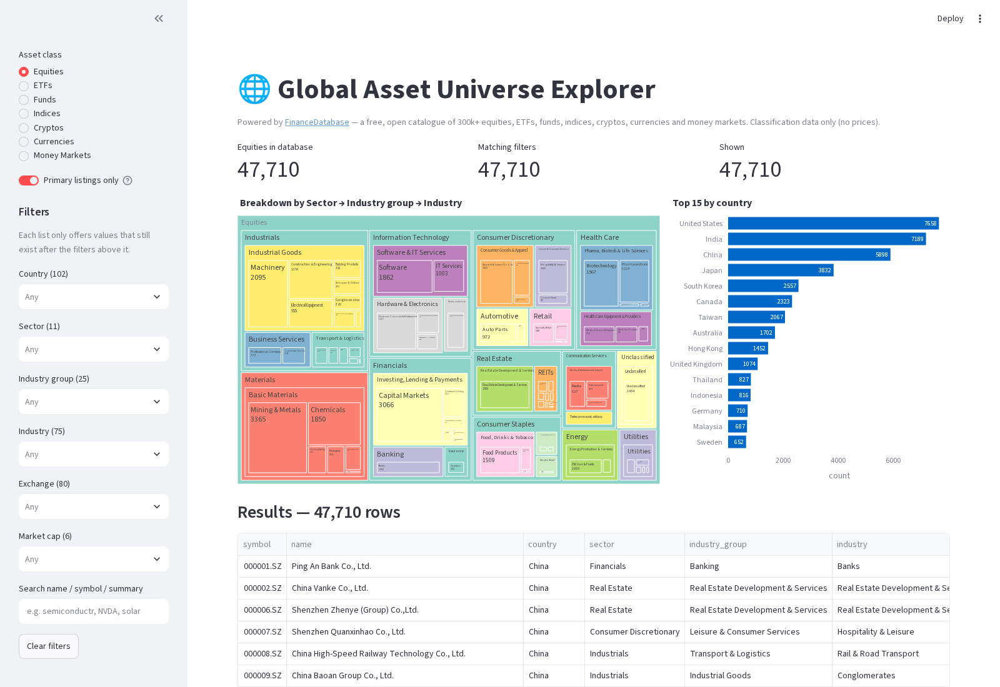
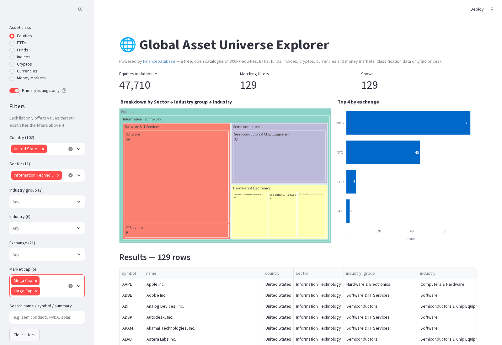
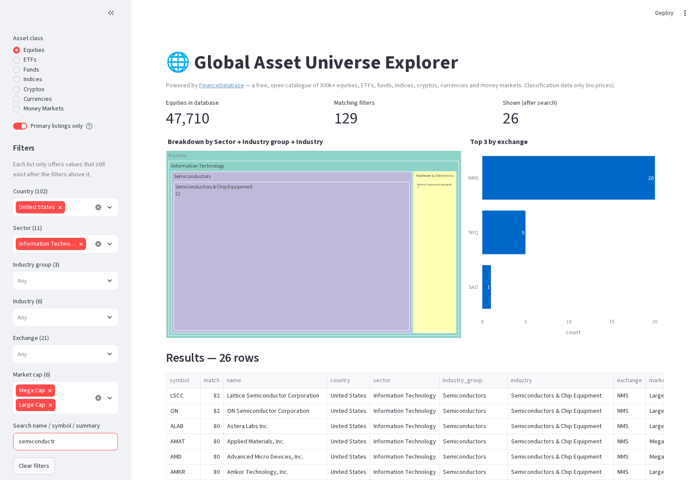

# Global Asset Universe Explorer (FinanceDatabase demo)

A one-page Streamlit app for browsing [FinanceDatabase](https://github.com/JerBouma/FinanceDatabase)
(`pip install financedatabase`): a free, MIT-licensed catalogue of 300k+ equities, ETFs, funds,
indices, cryptos, currencies and money markets, classified by country, sector, industry, category,
exchange and market-cap band. **Classification data only: no prices, no API keys, no trading.**

Source bookmark: https://x.com/Smartpigai/status/2098967844314861802



## What it does
- **Asset class picker:** Equities, ETFs, Funds, Indices, Cryptos, Currencies, Money Markets.
- **Primary listings only** (on by default for Equities/ETFs/Funds) hides cross-listed copies
  (for example Apple on Frankfurt/Stuttgart), using the library's `only_primary_listing`.
- **Cascading filters** come from each class's own fields, in order. Each list only offers values
  that still exist after the filters above it, and a choice that disappears is dropped.
  The order for Equities is country → sector → industry group → industry → exchange → market cap.
  ETFs and Funds use category group → category → family → exchange → currency, and so on.
- **Search** is typo-tolerant:
  - It does exact and substring matching on symbol and name, plus RapidFuzz fuzzy matching on names.
  - It also requires every word to appear in the summary, auto-correcting typos against the
    summaries' own vocabulary. For example, `semiconductr` still finds NVDA, AMD and AVGO.
  - A `match` column shows the score.
- **Charts:** a Plotly **treemap** (sector → industry group → industry, or category group → category)
  and a **bar chart** of the top countries or exchanges. Picking a single country switches the bar
  chart to its exchanges.
- **Results table** with live counts and a **CSV download** of the current selection.

| Filtered: US · Info Tech · Mega/Large cap | Typo search inside the filter |
|---|---|
|  |  |

## Run it (Windows PowerShell, Python 3.11–3.13)
```powershell
cd $HOME\Downloads\tech-demos
git fetch origin
git checkout -B demo/financedatabase-explorer origin/demo/financedatabase-explorer
cd apps\financedatabase-explorer
if (-not (Test-Path .venv)) { py -3 -m venv .venv }
Set-ExecutionPolicy -Scope Process -ExecutionPolicy Bypass -Force
.\.venv\Scripts\Activate.ps1
pip install -r requirements.txt
streamlit run app.py
```
Then open http://localhost:8501.

On macOS or Linux:
```bash
cd apps/financedatabase-explorer
python3 -m venv .venv && . .venv/bin/activate
pip install -r requirements.txt
streamlit run app.py
```

### First run and offline use
- The data isn't bundled in the pip package. The first time you open an asset class, the library
  downloads that class's Parquet file from GitHub (`raw.githubusercontent.com`) and caches it.
  The files total about **18 MB**: Equities is about 13 MB, the rest are 0.03–2 MB. Each takes a few seconds.
- The cache lives in `%LOCALAPPDATA%` (Windows) or `~/.cache/financedatabase` (Linux). Set
  `FINANCEDATABASE_CACHE_DIR` to move it. The library re-checks GitHub for updates about once a day.
- **Offline:** if an asset class has been cached, it loads from the cache. If it hasn't, the app
  shows a clear error and a **Retry download** button instead of crashing.
- Funds and Money Markets show a notice upstream that they're no longer maintained (since
  October 2026). They still load as-is; the app hides that warning.

## Tests
```powershell
python -m pytest -q
```
The tests cover option lists, cascading and stale-choice pruning, filtering, fuzzy and typo search,
and chart aggregations on a small fixture. One extra test checks that the app's unfiltered option
lists match the library's own `show_options()`. It's skipped when the data can't be downloaded.

## Screenshots (dev)
```bash
pip install -r requirements-dev.txt && python -m playwright install chromium
python capture.py   # starts streamlit headless and writes media/*.png
```

## Files
`app.py` (UI) · `explorer.py` (pure filter, search and aggregation logic plus per-class config) ·
`data.py` (loading and error wrapping) · `capture.py` · `tests/` · `PLAN.md`
