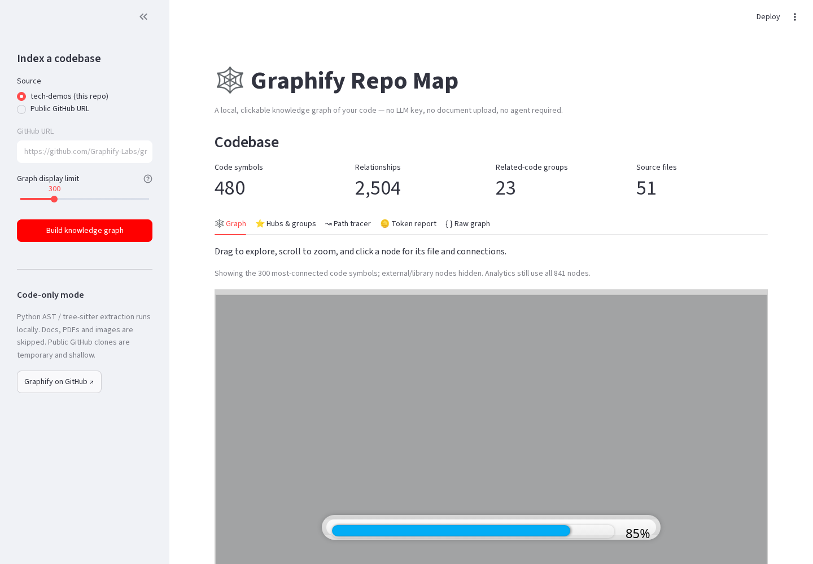

# graphify-repo-map

Explore a codebase as a clickable knowledge graph using [Graphify](https://github.com/Graphify-Labs/graphify) (`pip install graphifyy`) in **code-only mode**. Default to this tech-demos checkout or enter a public GitHub repository URL. No LLM key or account is required.



## Run it (Windows PowerShell)

```powershell
cd $HOME\Downloads
if (-not (Test-Path tech-demos)) { git clone https://github.com/mt10201/tech-demos.git }
cd tech-demos
git fetch origin
git checkout -B demo/graphify-repo-map origin/demo/graphify-repo-map
git log -1 --oneline
cd apps\graphify-repo-map
if (-not (Test-Path .venv)) { py -3 -m venv .venv }
Set-ExecutionPolicy -Scope Process -ExecutionPolicy Bypass -Force
.\.venv\Scripts\Activate.ps1
pip install -r requirements.txt
streamlit run app.py
```

macOS / Linux: `python3 -m venv .venv && . .venv/bin/activate && pip install -r requirements.txt && streamlit run app.py`. Git must be installed and `graphify` must be on PATH (installing requirements in the activated environment does this).

## Using it

1. Select **tech-demos** or **Public GitHub URL**, then **Build knowledge graph**. Public repositories are shallow-cloned into a temporary directory and removed when indexing finishes.
2. **Graph:** drag, zoom, hover or click nodes. Amber nodes are classes; blue nodes are functions. Large graphs are capped for browser responsiveness, but all analytics use the full graph.
3. **Hubs & groups:** inspect degree-ranked symbols and Graphify's code-only communities.
4. **Path tracer:** choose two symbols to see their shortest undirected connection and download a focused Markdown context bundle containing the path's source files.
5. **Token report:** compare estimated cl100k_base tokens in every indexed source file with a small focused bundle. This is an estimate, **not measured agent usage or a benchmark**.
6. **Raw graph:** download the Graphify JSON and inspect the extraction log.

## Caveats and API notes

- Tested with `graphifyy==0.9.103`. Extraction uses `graphify extract <path> --code-only --out <temp>`.
- Graphify 0.9 writes JSON-node-link data under **`links`**, not `edges`; the adapter accepts both. Node kinds and source locations come from Graphify node attributes.
- The CLI skips docs, PDFs and images in code-only mode. Community names remain numeric because LLM naming is disabled.
- Graph parsing and extraction are local. Pasting a GitHub URL does make a network `git clone`; only `https://github.com/owner/repo` URLs are accepted, without credentials or subpaths.
- Shortest paths ignore edge direction, which is useful for cross-module navigation but is not proof of a runtime call chain.
- Very large repositories may take several minutes to parse. Source files over 2 MB are excluded from token counts.

## Tests and media

```bash
pytest -q tests           # 19 offline tests
streamlit run app.py --server.port 8615 --server.headless true &
python scripts/capture.py http://localhost:8615  # optional: pip install playwright && playwright install chromium
```

`media/`: `01-knowledge-graph.png`, `02-hubs-groups.png`, `03-path-tracer.png`, `04-token-report.png`, and `05-walkthrough.mp4`.

## Layout

```
app.py               Streamlit UI and PyVis graph
graphmap/core.py     Graphify adapter, safe clone, analytics and token estimates
tests/               offline unit tests
scripts/capture.py   real-browser screenshots and video
media/               screenshots + MP4
PLAN.md              MVP plan and implementation notes
```
