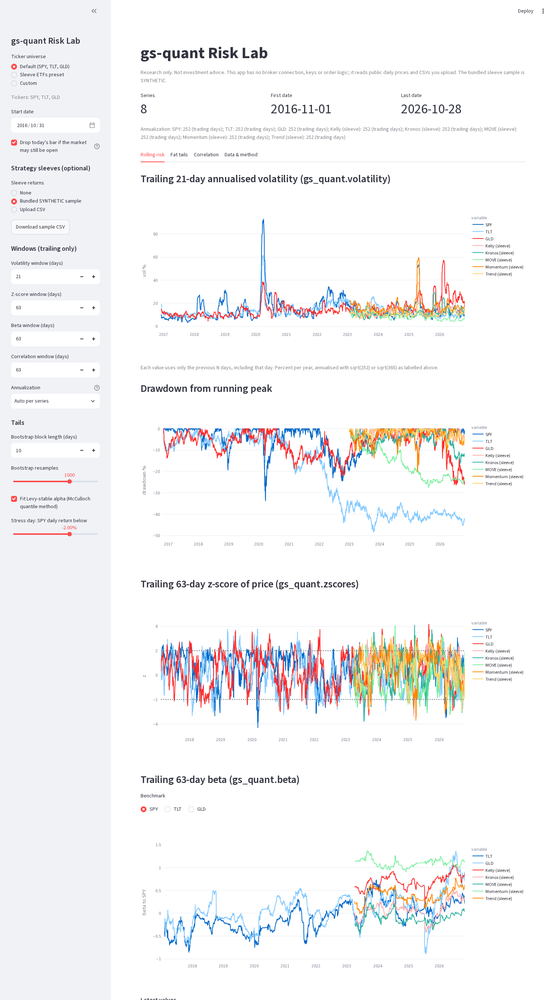

# gs-quant Risk Lab

Offline risk and fat-tail lab built on Goldman Sachs' open-source
[gs-quant](https://github.com/goldmansachs/gs-quant) (`gs_quant.timeseries`, Apache-2.0). Compare ETFs and your
strategy sleeves' daily returns: trailing volatility, drawdowns, z-scores, betas to SPY/TLT/GLD, fat-tail stats
(kurtosis, Hill tail index, CVaR 95/99 with block bootstrap, Levy-stable alpha) and correlation, including
correlation on SPY stress days.

> **Research only. Not investment advice.** No broker code, no API keys, no orders. No Marquee login is needed:
> only gs-quant's pure-pandas timeseries functions are used. The bundled sleeve CSV is **synthetic**.



## Run (Windows PowerShell)
```powershell
cd $HOME\Downloads
if (-not (Test-Path tech-demos)) { git clone https://github.com/mt10201/tech-demos.git }
cd tech-demos
git fetch origin
git checkout -B demo/gs-quant-risk-lab origin/demo/gs-quant-risk-lab
cd apps\gs-quant-risk-lab
if (-not (Test-Path .venv)) { py -3 -m venv .venv }
Set-ExecutionPolicy -Scope Process -ExecutionPolicy Bypass -Force
.\.venv\Scripts\Activate.ps1
pip install -r requirements.txt
streamlit run app.py
```
Open http://localhost:8501. macOS/Linux: `python3 -m venv .venv && . .venv/bin/activate && pip install -r requirements.txt && streamlit run app.py`.

Tests (offline): `python -m pytest -q tests`

## Using it
- **Ticker universe**: Default SPY/TLT/GLD, the *Sleeve ETFs preset* (SPYM, SCHF, SCHE, SPTL, VGIT, SCHP, IAU, SIVR,
  PDBC, USO, SLV, GLD) or any custom list (crypto like `BTC-USD` is auto-annualised with 365).
- **Sleeve returns**: upload a CSV with columns `date,sleeve,return` (decimal daily returns, `0.01` = +1%), e.g. a
  backtest or paper equity curve per strategy. *Download sample CSV* shows the format.
- Every table has a CSV download.

## Method
| Panel | How |
| --- | --- |
| Rolling vol, z-score, beta, correlation | `gs_quant.timeseries.volatility / zscores / beta / correlation` with `Window(N, N)`: trailing N observations, partial windows dropped. Tested: removing future data never changes past values. |
| Annualization | `sqrt(252)` for exchange-traded series, `sqrt(365)` for series with weekend data (crypto). Shown per series; overridable. |
| Max drawdown | `gs_quant.timeseries.max_drawdown`; duration = longest stretch below the prior peak (trading days), computed locally. |
| Excess kurtosis | `scipy.stats.kurtosis` (0 = Gaussian). |
| Hill tail index | alpha(k) on the k largest losses (and gains); point estimate at k = 5% of days, plus a stability plot across k. alpha < 2 = infinite variance. |
| CVaR 95/99 | Average loss on the worst 5% / 1% of days; moving-block bootstrap (default 10-day blocks, 1000 resamples) gives a p05-p95 band. |
| Levy-stable | McCulloch quantile estimator (scipy); table of P(move <= -k sd) empirical vs Gaussian vs stable. |
| Stress correlation | Correlation using only days SPY fell more than 2% (threshold adjustable). |

## Caveats
- Tail stats are descriptive over the chosen sample, not forecasts. Hill and stress-day estimates are noisy with
  small samples (check the stability plot and the stress-day counts).
- Betas are single-factor (one regression per benchmark), not a joint multi-factor model.
- yfinance data is free and occasionally revised or missing; today's bar is dropped by default while the market may
  be open.
- gs-quant's pricing/risk-model APIs need a Goldman Marquee account and are not used.

## Media
`media/01-rolling-risk.png`, `02-fat-tails.png`, `03-correlation-stress.png`, `04-sleeve-etf-preset-tails.png`,
`05-walkthrough.mp4`.
