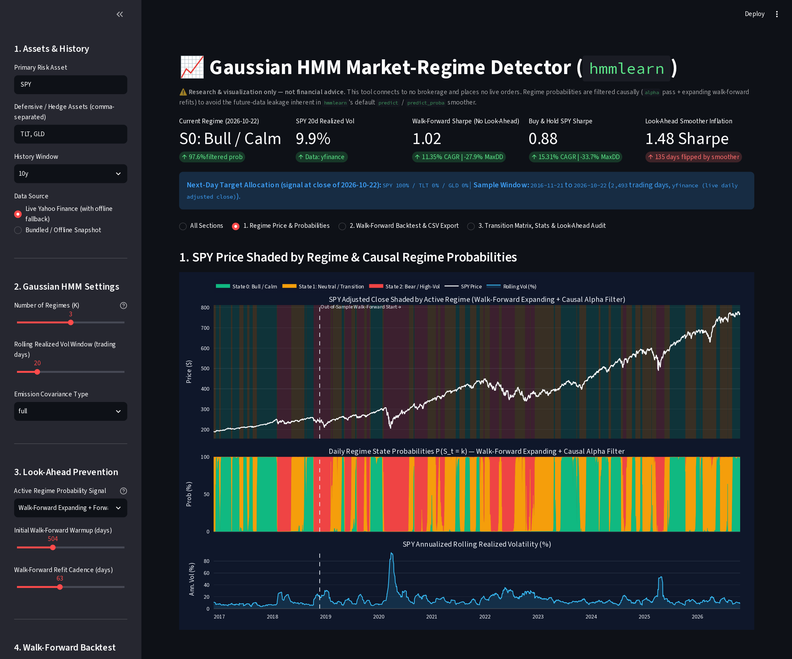
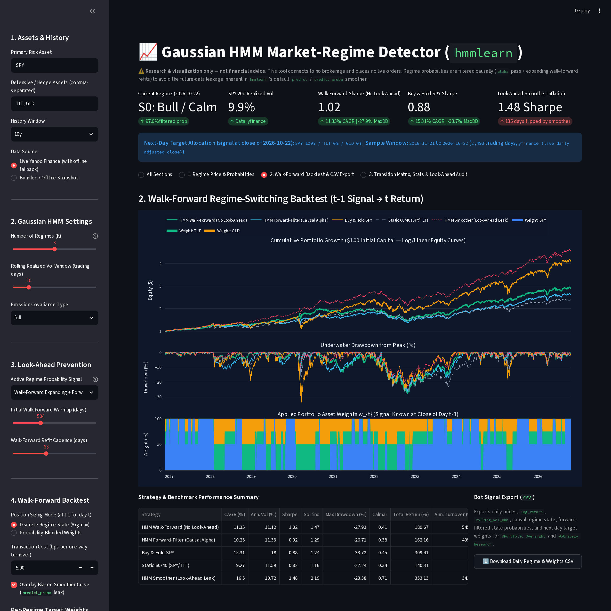
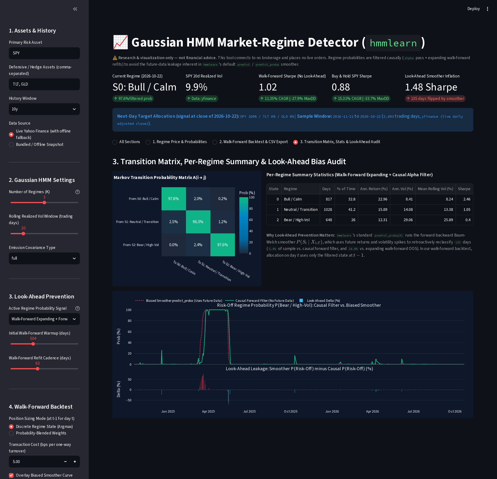

# Gaussian HMM Market-Regime Detector (`hmmlearn`)

Interactive Python + Streamlit demo that detects market volatility and return regimes using a **Gaussian Hidden Markov Model (`hmmlearn.hmm.GaussianHMM`)**, runs a strictly **causal walk-forward regime-switching backtest** across `SPY`, `TLT`, and `GLD`, and exports daily regime probabilities + target allocations as a CSV ready for **`@Portfolio Oversight`** and **`@Strategy Research`**.

- **Discovery Source:** Bookmarked X post [@0xTrackmind — HMM regime-allocation paper thread](https://x.com/0xTrackmind/status/2102413376148095032), alongside community validation threads from [@quantpedia (out-of-sample walk-forward regime testing)](https://x.com/quantpedia/status/2110290912932667854) and [@XARC_Real (warning on `hmmlearn` smoother look-ahead bias)](https://x.com/XARC_Real/status/2111711030208524330).
- **Disclaimer:** **For quantitative research and educational visualization only.** This tool does **not** provide financial or investment advice and does **not** place live orders.

---

## Screenshots

### 1. SPY Price Shaded by Regime & Causal Regime Probabilities


### 2. Walk-Forward Regime-Switching Backtest ($t-1 \to t$, No Look-Ahead) & Bot CSV Export


### 3. Transition Matrix Heatmap, Per-Regime Summary Stats & Look-Ahead Bias Audit


---

## Key Features & Methodological Guarantees

### 1. Deterministic State Ordering by Realized Volatility (No Label Switching)
Standard EM fits on `GaussianHMM` assign state indices `0..K-1` arbitrarily across refits, causing "State 0" to flip between bull and bear regimes on every expanding-window step.
- `sort_hmm_states_by_volatility(model)` deterministically permutes `startprob_`, `transmat_`, `means_`, and `_covars_` in-place by ascending state mean realized volatility (`means_[:, 1]`, with `-means_[:, 0]` as tie-breaker):
  - **State 0 (`Bull / Calm`)**: lowest realized volatility (risk-on)
  - **State 1 (`Neutral / Transition`)**: intermediate volatility
  - **State $K-1$ (`Bear / High-Vol`)**: highest realized volatility (risk-off)

### 2. Look-Ahead Bias Prevention: Causal Forward Filter ($\alpha_t$) vs. Biased Smoother ($\gamma_t$)
Calling `model.predict(X)` (Viterbi) or `model.predict_proba(X)` (Forward-Backward smoother) in `hmmlearn` computes posterior probabilities conditioned on the **entire dataset** $P(S_t \mid X_{1:T})$, leaking future crashes backward into prior days.
- **Causal Forward-Only Filter (`forward_filter_proba`)**: Recursively updates $\alpha_t(k) \propto p(x_t \mid S_t = k) \sum_j \alpha_{t-1}(j) A_{jk}$ in log-space (`scipy.special.logsumexp`) using only observations $X_{1:t}$ available up to day $t$.
- **Expanding-Window Walk-Forward (`walk_forward_hmm_inference`)**: Periodically refits the `GaussianHMM` strictly on historical data $[0, t]$ (`min_train_days=504`, `refit_every=63`), sorts states by volatility, and filters forward on the out-of-sample block.
- **Strictly Lagged Execution ($t-1 \to t$)**: Day $t$'s portfolio return is earned on `applied_weights[t] = target_weights[t - 1]`, ensuring zero same-bar look-ahead.

### 3. Default 10-Year Backtest Summary (`SPY` / `TLT` / `GLD`, 3 States, 20d Vol, 5 bps Cost)

| Strategy | Total Return | CAGR | Ann. Vol | Sharpe | Sortino | Max Drawdown | Calmar |
| :--- | ---: | ---: | ---: | ---: | ---: | ---: | ---: |
| **HMM Walk-Forward (No Look-Ahead)** | **189.67%** | **11.35%** | **11.12%** | **1.02** | **1.47** | **-27.93%** | **0.41** |
| **HMM Forward-Filter (Causal Alpha)** | 163.93% | 10.23% | 11.33% | 0.92 | 1.29 | -26.71% | 0.38 |
| **Buy & Hold SPY** | 309.41% | 15.31% | 18.00% | 0.88 | 1.24 | -33.72% | 0.45 |
| **Static 60/40 (SPY/TLT)** | 141.70% | 9.27% | 11.59% | 0.82 | 1.16 | -27.24% | 0.34 |
| *HMM Smoother (Look-Ahead Leak — Audit Only)* | *354.58%* | *16.50%* | *10.72%* | *1.48* | *2.19* | *-23.38%* | *0.71* |

> **Why Look-Ahead Auditing Matters:** On the exact same 10-year `SPY`/`TLT`/`GLD` sample, using `hmmlearn`'s default `predict_proba(X)` smoother retroactively flips **135 trading days (5.4%)** vs. the causal forward filter (and **648 days / 24.0%** vs. expanding-window walk-forward), artificially inflating the apparent Sharpe ratio from **1.02** to **1.48**.

### 4. CSV Export Schema for `@Portfolio Oversight` & `@Strategy Research`
Clicking **Download Daily Regime & Weights CSV** exports a daily table with:
- `date`, `close_<TICKER>`, `log_return`, `rolling_vol_ann`
- `causal_regime_id`, `causal_regime_label`, `smoother_regime_id`, `smoother_regime_label`
- `prob_state_0_bull_calm`, ..., `prob_state_<K-1>_bear_high_vol`
- `target_weight_<TICKER>` (end-of-day $t$ signal for day $t+1$) and `applied_weight_<TICKER>` (weight applied during day $t$)
- `strategy_daily_return`, `strategy_equity`, `buy_hold_<PRIMARY>_equity`

---

### 5. Gaussian vs. Student-t Emissions (Fat-Tail Toggle)
The sidebar's **2. HMM Settings** section has an **Emission Distribution** toggle (`Gaussian` / `Student-t (fat tails)`) and a **Student-t Degrees of Freedom (nu)** slider (default 5; lower = fatter tails). Student-t emissions (`StudentTHMM`, `fit_student_t_hmm`) down-weight single shock days instead of treating them as proof of a regime change. With **Show Gaussian vs. Student-t Comparison** checked (section 4), the app fits both models walk-forward and shows regime switches per year, 1-2 day whipsaws per year, average regime spell length, CAGR, Sharpe, and max drawdown side by side (out-of-sample days only).

On the bundled offline snapshot (3 states, 20d vol, default settings, nu = 5): Gaussian 10.9 switches/yr, 2.2 whipsaws/yr, 0.95 Sharpe, -27.9% max DD; Student-t 8.9 switches/yr, 0.8 whipsaws/yr, 1.01 Sharpe, -27.3% max DD.

## Quickstart

```bash
cd apps/hmm-regime-detector
python3 -m venv .venv
source .venv/bin/activate
pip install -r requirements.txt
streamlit run app.py
```

### Run Unit Tests
```bash
pytest -v
```
