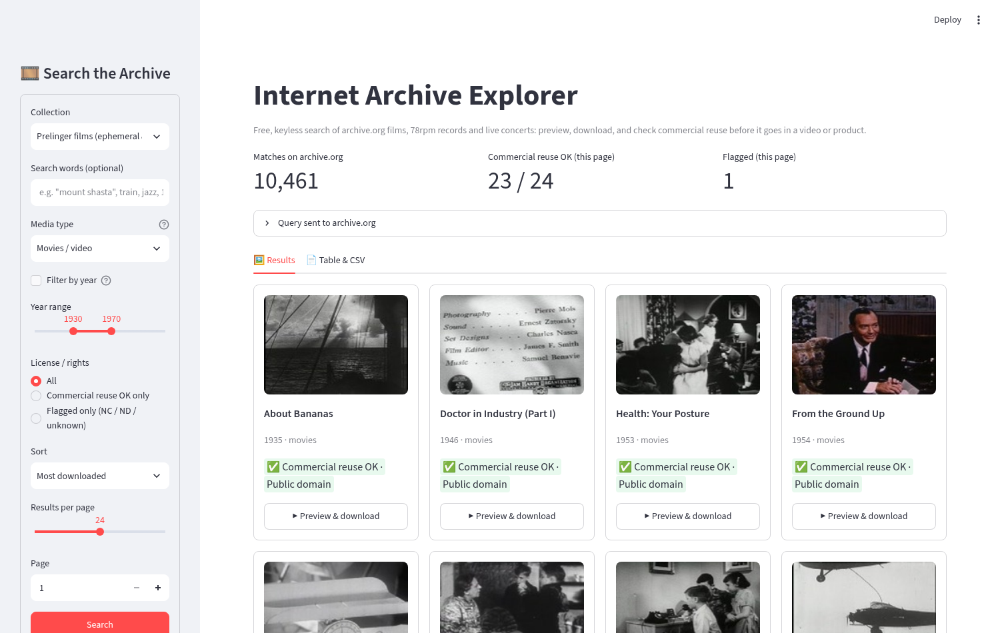

# internet-archive-explorer

Free, keyless explorer for [archive.org](https://archive.org): search **Prelinger films**, **78rpm records (Great 78 Project)**, **Live Music Archive (etree) concerts**, or anything by free text. Preview thumbnails, play video and audio in the app, download files in one click, and export a CSV with each item's license so you can tell what is safe to reuse in a video or product.

Bookmark source: [Internet Archive API](https://x.com/ElliotPadfield/status/2113393903923581149).



## Run it (Windows PowerShell)

```powershell
cd $HOME\Downloads
if (-not (Test-Path tech-demos)) { git clone https://github.com/mt10201/tech-demos.git }
cd tech-demos
git fetch origin
git checkout -B demo/internet-archive-explorer origin/demo/internet-archive-explorer
git log -1 --oneline
cd apps\internet-archive-explorer
if (-not (Test-Path .venv)) { py -3 -m venv .venv }
Set-ExecutionPolicy -Scope Process -ExecutionPolicy Bypass -Force
.\.venv\Scripts\Activate.ps1
pip install -r requirements.txt
streamlit run app.py
```

macOS / Linux: `python3 -m venv .venv && . .venv/bin/activate && pip install -r requirements.txt && streamlit run app.py`.

You don't need an API key or account.

## Using it

1. **Sidebar:** pick a collection preset or *Anything (free-text search)*, and add search words if you like (`"mount shasta"` in quotes searches for the exact phrase). Optionally tick **Filter by year** and set the range. Choose a media type, a **License / rights** filter (*All*, *Commercial reuse OK only*, *Flagged only*), a sort order and a page size, then press **Search**.
2. **Results tab:** a grid of thumbnails, each with a green ✅ *Commercial reuse OK* badge or an amber ⚠️ *Flagged* badge. **▶ Preview & download** opens the item panel. It has a video player (choose the file) or an audio player (choose the track), the license link and rights text, and a **Download files** list. Files up to 200 MB download through the app; larger ones open on archive.org.
3. **Table & CSV tab:** a sortable table and **CSV of this page**. **Fetch top 500 results for CSV** does the same for up to 500 matches in one request. Columns: `title, identifier, year, collection, mediatype, commercial_ok, license, license_reason, license_url, rights, creator, source_url`.

## The "commercial reuse OK?" rule

An item is marked **OK** only when its `licenseurl` is **Public Domain (Mark / dedication)**, **CC0**, **CC BY** or **CC BY-SA**. It is also marked OK when it has no license URL but its rights text plainly says *public domain* (with no "not", NC, or "all rights reserved"). Everything else is **flagged**: any **NC** (NonCommercial), any **ND** (NoDerivatives), other licenses, and **unknown** (nothing declared). With *Commercial reuse OK only*, archive.org filters on the server side with wildcards on `licenseurl`.

BY and BY-SA still require attribution, and BY-SA requires share-alike. The CSV keeps `license_url`, `rights` and `source_url` so you can credit each item.

## Being polite to archive.org

- Every API response is cached on disk for 24 h in `.ia_cache.sqlite` (git-ignored), via requests-cache. Streamlit also caches in memory.
- Requests that miss the cache are throttled to **1 per second**. 429 and 503 responses are retried with back-off, honouring `Retry-After`.
- The app sends a descriptive User-Agent. One search is one request, and the 500-row CSV is also one request.

## Caveats

- **The flags are a screening aid, not legal advice.** archive.org metadata is uploader-supplied. Check the item page before you publish.
- **Prelinger:** many items (about 8.6k of 10.4k) have no `licenseurl`, so they are flagged *Unknown* even though the collection is generally described as public domain. Check the item page.
- **78rpm:** most records declare no license and are flagged. Pre-1926 US recordings may now be public domain, but the app does not infer that. Recordings themselves can carry separate rights.
- **Live concerts (etree):** almost none declare a license. They are taper or band-permission recordings, non-commercial in practice, so they are flagged. `stream_only` items (for example many Grateful Dead soundboards) play in the app but have no downloads.
- **Year filter:** it drops items that have no year. Leave it off to see everything.
- Thumbnails are loaded straight from archive.org, and some can fail to load when many load at once. Reload the page to retry.

## Tests and media

```bash
pip install -r requirements.txt
pytest -q tests           # 37 offline tests, archive.org mocked with `responses`
streamlit run app.py --server.port 8611 --server.headless true &
python scripts/capture.py http://localhost:8611   # needs `pip install playwright`
```

`media/`: `01-prelinger-results.png`, `02-film-player.png`, `03-film-downloads.png`, `04-78rpm-commercial-ok.png`, `05-78rpm-audio-player.png`, `06-live-concerts-flagged.png`, `07-mount-shasta-table-csv.png`, and the walkthrough video `08-walkthrough.mp4`.

## Layout

```
app.py                 Streamlit UI
iaexplorer/client.py   query builder, cached + throttled archive.org client
iaexplorer/rights.py   license -> commercial-reuse verdict
iaexplorer/media.py    file picking, URLs, CSV export
tests/                 offline tests
scripts/capture.py     Playwright screenshots + video
PLAN.md                project plan
```
