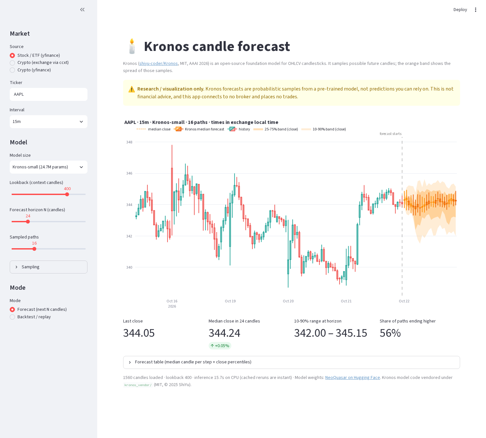

# Kronos candle forecast

Local Streamlit demo of **[Kronos](https://github.com/shiyu-coder/Kronos)**, the open-source
foundation model for financial candlesticks (OHLCV), MIT-licensed, AAAI 2026
([paper](https://arxiv.org/abs/2508.02739)). Pick a stock or crypto pair, and Kronos samples
several possible paths for the next N candles; the app draws the median forecast and a
10-90 % / 25-75 % band. A backtest/replay mode forecasts from a past cutoff and scores it
against what actually happened.

> ⚠️ **Research / visualization only.** Not financial advice. The app talks to no broker,
> needs no API keys and places no trades.



## Features
- **Markets:** stocks / ETFs via `yfinance` (e.g. `AAPL`, `SPY`), crypto pairs via `ccxt`
  public OHLCV (Coinbase default, Kraken, OKX, Binance) or yfinance crypto (`BTC-USD`).
- **Intervals:** 5m, 15m, 1h, 1d. Lookback (context) and horizon N sliders.
- **Model size:** Kronos-mini (4.1M), **Kronos-small (24.7M, default)**, Kronos-base (102.3M).
- **Forecast mode:** K independent sampled paths -> median candles + percentile bands.
  Stock forecasts only use trading-session bar times (no nights/weekends).
- **Backtest / replay:** choose a cutoff, overlay the real candles, and get MAE and MAPE on
  close, step-by-step directional accuracy, end-of-horizon direction and band coverage, plus
  a flat "no change" baseline MAE.
- Model is loaded once (`st.cache_resource`); candles cached 5 min; identical forecasts cached.
- Shareable presets through the URL, e.g.
  `?market=crypto&exchange=coinbase&symbol=BTC/USD&interval=1h&mode=backtest&horizon=24&back=48`.

## Run it (Windows PowerShell, CPU only)
Python **3.10-3.13** (64-bit).

```powershell
cd $HOME\Downloads\tech-demos\apps\kronos-candle-forecast
py -m venv .venv
.\.venv\Scripts\Activate.ps1
python -m pip install --upgrade pip
pip install -r requirements.txt      # on Windows this installs the CPU build of torch
streamlit run app.py
```

macOS / Linux: same steps with `python3 -m venv .venv && source .venv/bin/activate`. On Linux,
install CPU torch first to avoid the large CUDA wheel:
`pip install torch --index-url https://download.pytorch.org/whl/cpu`.

**First run** downloads the weights from Hugging Face (NeoQuasar) into your HF cache:
about 16 MB tokenizer + 95 MB for Kronos-small (Kronos-base about 390 MB; mini 16 MB + its own 16 MB tokenizer). The CPU torch wheel itself is about 200-250 MB.
After that, everything except fetching candles works offline. A forecast with Kronos-small,
lookback 400, 16 paths and 24 candles takes about 10-30 s on an 8-core laptop CPU; fewer
paths, a shorter horizon or Kronos-mini is faster.

## Tests
```powershell
python -m pytest -q
```
Tests cover data cleaning, future timestamps and the metrics; they need no network or model.

## How it works
- `kronos_demo/data.py`: fetch candles and normalise them to Kronos's columns
  (`timestamps, open, high, low, close, volume, amount`); `amount` = volume x mean(OHLC).
  Stock stamps are kept in exchange local time, crypto in UTC.
- `kronos_demo/forecast.py`: loads tokenizer + model with the upstream `from_pretrained`.
  Upstream `predict(sample_count=K)` averages its samples, so to keep every path the demo
  passes the same series K times to `predict_batch(sample_count=1)`, one path per batch row.
- `kronos_demo/metrics.py`: MAE, MAPE, directional accuracy, band coverage.
- `kronos_demo/charts.py`: Plotly candlesticks, bands and the actual-candle overlay.

## Notes and caveats
- Kronos-small/base have a 512-candle context; mini handles up to 2048 (the slider caps at 1024).
- yfinance limits: 5m/15m about 60 days, 1h about 730 days of history.
- Binance blocks US IP addresses; use Coinbase, Kraken or OKX there.
- Users who have tested Kronos report it is most useful for short intraday/crypto horizons and
  much weaker on daily candles. One backtest cutoff is one sample: slide the cutoff around.
- Holidays are not skipped in stock forecast timestamps.

## Attribution
Kronos model code in `kronos_vendor/model/` is copied unmodified from
[shiyu-coder/Kronos](https://github.com/shiyu-coder/Kronos) (MIT, © 2025 ShiYu); see
`kronos_vendor/LICENSE` and `kronos_vendor/NOTICE.md`. Weights:
[huggingface.co/NeoQuasar](https://huggingface.co/NeoQuasar).

Source: X bookmark https://x.com/carm1nee/status/2112335978165583977 (2026-10-21).
