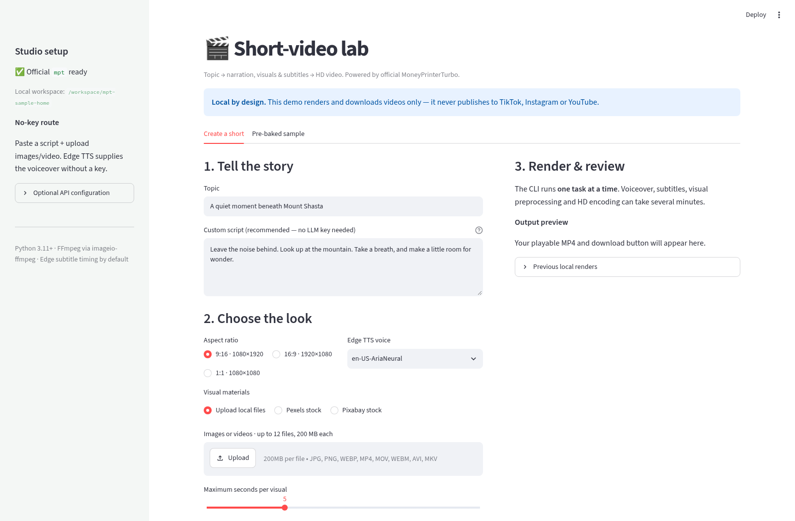

# MoneyPrinterTurbo Short-Video Lab

A local Streamlit creative lab wrapping the official [MoneyPrinterTurbo](https://github.com/harry0703/MoneyPrinterTurbo) (MIT). Turn a topic or custom script and local/stock visuals into a playable, downloadable HD video with Edge TTS narration and subtitles. **It never publishes to TikTok, Instagram, YouTube or anywhere else.**

Bookmark source: [MoneyPrinterTurbo post on X](https://x.com/arceyul/status/2117243034693714299).



## Run it (Windows PowerShell)

```powershell
cd $HOME\Downloads
if (-not (Test-Path tech-demos)) { git clone https://github.com/mt10201/tech-demos.git }
cd tech-demos
git fetch origin
git checkout -B demo/moneyprinter-short-video-lab origin/demo/moneyprinter-short-video-lab
git log -1 --oneline
cd apps\moneyprinter-short-video-lab
if (-not (Test-Path .venv)) { py -3.11 -m venv .venv }
Set-ExecutionPolicy -Scope Process -ExecutionPolicy Bypass -Force
.\.venv\Scripts\Activate.ps1
pip install -r requirements.txt
streamlit run app.py
```

Python **3.11+** is required; 3.11 is the upstream recommendation. On macOS/Linux: `python3.11 -m venv .venv && . .venv/bin/activate && pip install -r requirements.txt && streamlit run app.py`.

**Install surprise:** `mpt` is the official package maintained by `harry0703`. The PyPI package named `MoneyPrinterTurbo` is maintained by a third party and is deliberately not used. The lab uses the `mpt cli` shipped in the same virtual environment as Streamlit, so activating `.venv` matters.

## No-key path

1. Enter a topic and **paste a complete script**. Topic-only AI script generation needs an LLM configured upstream.
2. Select **Upload local files**, then add images/videos you have permission to use (up to 12, 200 MB each).
3. Choose 9:16 (1080×1920), 16:9 (1920×1080) or 1:1 (1080×1080), an Edge TTS voice and clip duration.
4. Select **Generate HD video**. The app runs one CLI task, shows upstream stage logs, then offers playback and MP4 download.

Custom script + local media + `en-US-AriaNeural` / other Edge TTS + Edge timestamp subtitles needs **no API key**. This was tested end to end with official `mpt` 1.3.9. Network access is still needed for Edge TTS. BGM is deliberately off in this demo.

## Optional keys

Keys are **not accepted or stored by this Streamlit app**. Configure them only in MoneyPrinterTurbo's own local `config.toml` using its WebUI/documentation; the lab displays boolean readiness only.

- **AI script generation:** configure the LLM provider selected in `[app]`, including OpenAI-compatible and other providers supported upstream. Leave the custom script blank to use it.
- **Pexels / Pixabay:** each stock source needs its respective free API key in `[app].pexels_api_keys` / `pixabay_api_keys` (lists in mpt 1.3.9). Stock-provider licensing and rate limits apply.
- By default the lab stores its isolated config, uploads and tasks under `~/.moneyprinter-short-video-lab` (override with `MPT_LAB_HOME`). To configure, run `MPT_HOME=$HOME/.moneyprinter-short-video-lab mpt webui` on Unix or `$env:MPT_HOME="$HOME\.moneyprinter-short-video-lab"; mpt webui` in PowerShell.

## Heavy dependencies / limits

The official install includes MoviePy, PyAV, imageio-ffmpeg and speech packages and can take a while. FFmpeg normally comes via imageio-ffmpeg; configure a system binary in `config.toml` if detection fails. Subtitles default to Edge timestamps; optional local Whisper transcription can download a multi-GB model and is not enabled by this lab. Rendering is CPU-heavy, one task at a time, with a 30-minute timeout. Keep the browser tab open during generation.

## Tests and media

```bash
pip install pytest
pytest -q tests
```

`media/` includes the real 8-second `sample-generated.mp4` (local images + custom script + Edge TTS + subtitles, no keys), UI screenshots and an app walkthrough MP4. The placeholder landscape artwork is generated for this demo; no stock media is bundled.

## Layout

```
app.py                 Streamlit creation, readiness, playback/download UI
video_lab/runner.py    config checks, uploads, bounded CLI adapter/results
tests/                 offline critical-logic tests
scripts/capture.py     real-browser screenshot/video capture
media/                 real generated sample + app screenshots/walkthrough
requirements.txt       Streamlit + official mpt
PLAN.md                project plan
```
